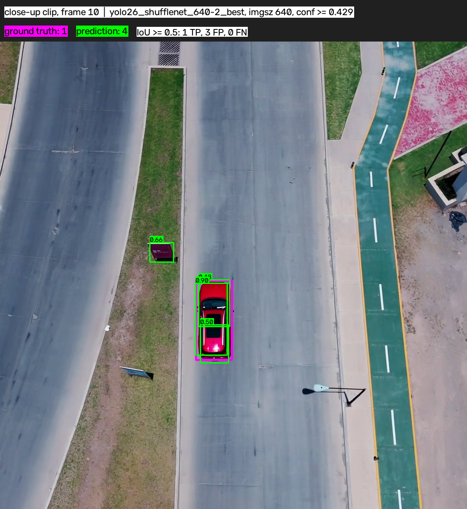
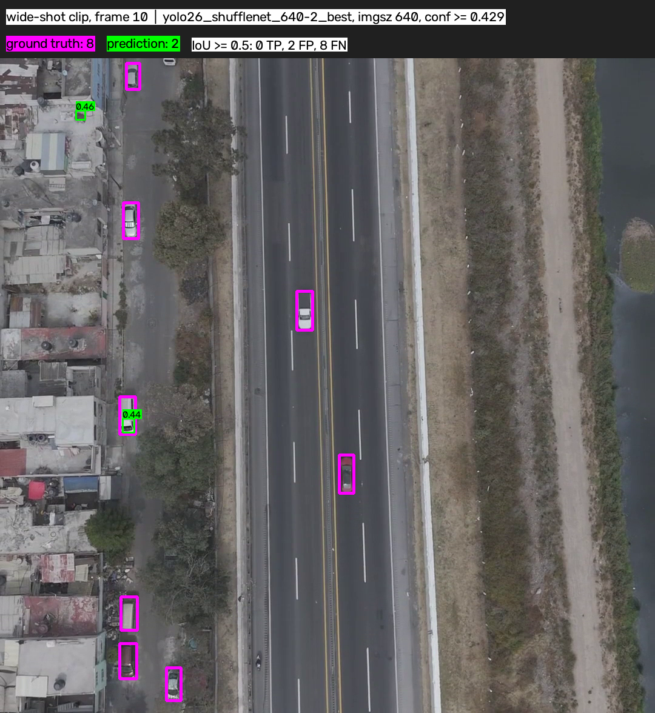
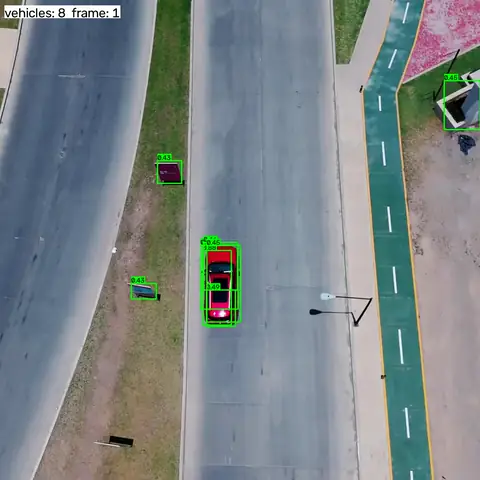
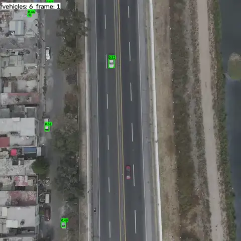

README for the Computer Vision Engineer test task.
Goal: train a simple object detector on the provided training data, with fewer than 500k parameters.

# Data
Per the task conditions, the following videos are available for training:
+ [Highway interchange](https://www.pexels.com/video/8968356)
+ [Rural highway](https://www.pexels.com/video/5382494)
+ [Simple highway](https://www.pexels.com/video/8457857)
+ [Urban intersection](https://www.pexels.com/video/3405804)

The following test clips were used to compute the target metrics:
+ [city highway, daytime](https://www.pexels.com/video/32179597) (0-200 meters)
+ [rural highway, wide-shot](https://www.pexels.com/video/aerial-view-of-highway-in-urban-area-30616906/) (200-400 meters)
    + Note: this video is not part of the task conditions. It was added because the task requires the target metrics to be computed separately for the `0-200` meter and `200-400` meter ranges, while the video provided in the task contains only close-range frames.
    + Note 2: after estimating distances, it turned out that the average distance in this video is ~100 meters rather than 200, so the metrics in the table below are computed for the 100-400 meter range.

Important: the test clips were not used in any way for hyperparameter tuning or for making decisions about the training approach.

## Data preprocessing
All videos fed into the model go through simple preprocessing — they are cropped to a square. The training videos, which are 1920x1080, are cropped to `1080x1080`. The motivation for cropping to a square is that YOLO works with square `640x640` inputs by default. If a rectangular video is fed in, YOLO downscales it via letterboxing during preprocessing. Since we are working with small objects and training a very small model, letterboxing would shrink the boxes even further and also hurt training (because part of the image would be empty padding). For this reason, I decided to crop the videos at the preprocessing and annotation stage. The downside of this approach is that the model no longer sees the edges of the image, but this is an acceptable trade-off for such a small model, since our region of interest is usually in the center of the frame.

The preprocessing script can be found in `scripts/video-preprocessing`.

### Dataset split
The validation set needed frames at both close and far distances. However, none of the training videos contained both close and far frames on its own. Because of this, the validation set was drawn from the same training videos that were used for training. To avoid data leakage, contiguous segments of each such video were used as validation. In addition, a gap was left between each validation segment and the training segment, so that the frames would be less similar to each other.

# Code
Requirements:
+ `Python 3.14.4`.
+ `PyTorch Cuda13`.
+ Please see `requirement.txt` for a full list of dependencies.
+ Please also ensure that you have internet on the first, in order to download Ultralytics models.
+ You need to have `ffmpeg` installed in order to preprocess video clips, though this is not required, bc clips is already preprocessed.

Directory structure:
```
Computer-Vision-Test-Task/
├── Annotation-guidelines.md           # Rules used when labeling frames in CVAT
├── yolo26-shufflenet.yaml             # Model config: YOLO26 neck/head on a ShuffleNetV2-x0.5 backbone (nc=1)
├── split_dataset.py                   # Splits one CVAT YOLO export (one clip) into train/val by contiguous frame ranges + gap
├── merge_datasets.py                  # Merges split clips into a single YOLO dataset in input/train/
├── train-notebook.ipynb               # Training pipeline
├── test-notebook.ipynb                # Evaluation / inference on the test videos
│
├── raw_data/                          # CVAT exports go here
│
├── input/
│   ├── train/                         # Merged YOLO dataset, generated by train-notebook.ipynb
│   └── test/
│       ├── eval_close-up_cropped.mp4  # Close-up shot
│       ├── eval_wide-shot_cropped.mp4 # Wide shot
│       └── annotated/                 # Ground-truth annotations for the test videos
│
├── scripts/
│   ├── annotation-helper/             # Auto-annotation tooling for CVAT
│   │   ├── how-to-auto-annotate.md
│   │   ├── prepare_teacher_data.py
│   │   └── track_to_cvat.py
│   └── video-preprocessing/
│       └── how-to.md
│
├── weights/
│   └── yolo26_shufflenet_640_best.pt  # Final trained model
│
└── output/
    ├── test_preds/
    │   ├── eval_close-up_cropped_pred.mp4
    │   └── eval_wide-shot_cropped_pred.mp4
```

## Additional data
Annotated data is available here:
+ [Annotated train dataset](https://drive.google.com/file/d/18uiaHmb5tAvT4-Nt1WkZoOlNnIRBaQvB/view?usp=sharing)
  + Paste `raw_data` folder directly into the project root with replace.
+ [Annotated test video clips](https://drive.google.com/file/d/13vr_NM2AEspT_ZYNvMkZel9Y9D6xQkqC/view?usp=sharing)
  + Paste `annotated` folder into `input/test/` folder with replace.

# Labels
To keep annotation consistent and to resolve edge cases, I wrote annotation guidelines. They can be found in `Annotation-guidelines.md`.

I used CVAT Community Edition to annotate the video clips.

## Annotation approaches I tried:
+ Using the built-in `YOLOv7` in CVAT for pre-annotation. I tried different thresholds.
    + Result: very noisy, low-quality annotations with a large number of false negatives.
+ Linear interpolation in CVAT to create boxes between two keyframes.
    + Result: not very useful, since objects rarely move in a strictly straight line.
+ Using `OpenCV` trackers to follow an annotated object across subsequent frames.
    + Result: low annotation quality, since the tracker struggled with shadows, road markings, and objects not moving in a straight line.
+ Using a larger model, `YOLO26x` (COCO checkpoint, since the Aerial one is prohibited by the rules), for pre-annotation.
    + Result: low quality, with a large number of false negatives. Almost zero accuracy on distant objects (200+ meters). You can read about it in `/scripts/annotation-helper/how-to-auto-annotate.md`.
+ Fine-tuning `YOLO26x` on already-annotated data to improve pre-annotation quality for subsequent clips.
    + Result: slightly better quality, but due to likely mistakes in the fine-tuning process, a new problem appeared: duplicate boxes overlapping each other. You can read about it in `/scripts/annotation-helper/how-to-auto-annotate.md`


+ Using CVAT's built-in `TransT` model for object tracking.
    + Result: excellent performance at tracking annotated objects, even when they pass through shadows, move along a non-straight trajectory, or are very far away. This is the method that was used for most of the video clip annotation.
    + Problems: the current implementation is very slow and doesn't fully utilize the GPU. It is incompatible with pre-annotation by YOLO models. It doesn't handle objects leaving the frame.

# Training
As the target detector architecture, I used a slimmed-down neck and head from `YOLO26n` with `ShuffleNet` as the backbone. This was done to preserve the pretrained weights as much as possible instead of destroying them. With radical pruning like this (which is needed to fit into the 500k parameter limit), a lot of connections are broken and the model's accuracy drops catastrophically.

With this architecture, the parameter count during training was `408,638`.

# Eval setup
To compute metrics on the test videos, I annotated them and then used a script that assigns boxes to categories based on their estimated distance. I then computed the target metrics for each category.

# Results
Target metrics:
| clip | band | vehicles | GT boxes | detection rate | precision | false alarms/min | vehicles detected | TTFD median, s | TTFD max, s | AP50 |
|---|---|---:|---:|---:|---:|---:|---:|---:|---:|---:|
| **close-up** | 0-100 m | 10 | 1546 | 0.878 | 0.358 | 68.6 | 10/10 | 0.00 | 0.70 | 0.729 |
|  | 100-400 m | 0 | 0 | – | 0.000 | 92.2 | 0/0 | – | – | – |
| **wide-shot** | 0-100 m | 6 | 549 | 0.115 | 0.364 | 7.4 | 4/6 | 0.28 | 4.13 | 0.156 |
|  | 100-400 m | 11 | 1150 | 0.264 | 0.324 | 773.6 | 9/11 | 0.03 | 0.80 | 0.198 |
| **all clips** | 0-100 m | 16 | 2095 | 0.678 | 0.358 | 55.9 | 14/16 | 0.00 | 4.13 | 0.579 |
|  | 100-400 m | 11 | 1150 | 0.264 | 0.259 | 234.3 | 9/11 | 0.03 | 0.80 | 0.146 |

Frames from the test videos showing predicted and ground-truth boxes (one frame per test video):

<p align="center">
  
  
</p>

Videos of the detector running on the test clips (one video per test clip):

<table>
  <tr>
    <th>close-up</th>
    <th>wide-shot</th>
  </tr>
  <tr>
    <td>
      <a href="output/eval_close-up_cropped_pred.mp4">
        
      </a>
    </td>
    <td>
      <a href="output/eval_wide-shot_cropped_pred.mp4">
        
      </a>
    </td>
  </tr>
</table>

# What next
+ Try preprocessing the videos with OpenCV to enhance contrast.
+ Make a better train/validation split with a similar distribution of large and small boxes. Or use a separate video for validation.
+ Refine the annotation guidelines. Resolve the edge cases found during annotation.
    + Be more consistent.
+ Improve the auto-annotation process.
    + Add scripts for post-checking annotated data that would flag anomalies.
+ Try gradual pruning of a larger model (prune a few layers, then fine-tune to partially recover the metrics, then prune again, and so on until the parameter count is acceptable) and compare the results.

# Disclaimer
I used Claude Code as a coding assistant, and as a helper for working through difficult questions.
